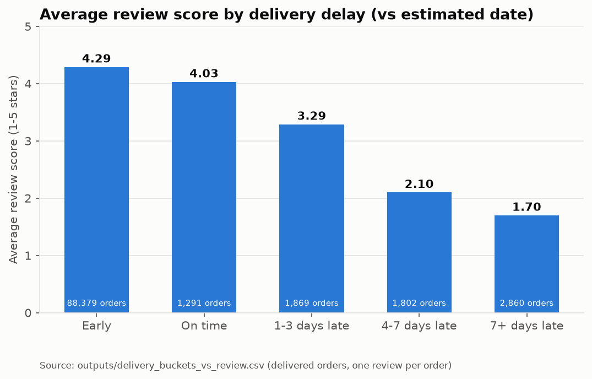
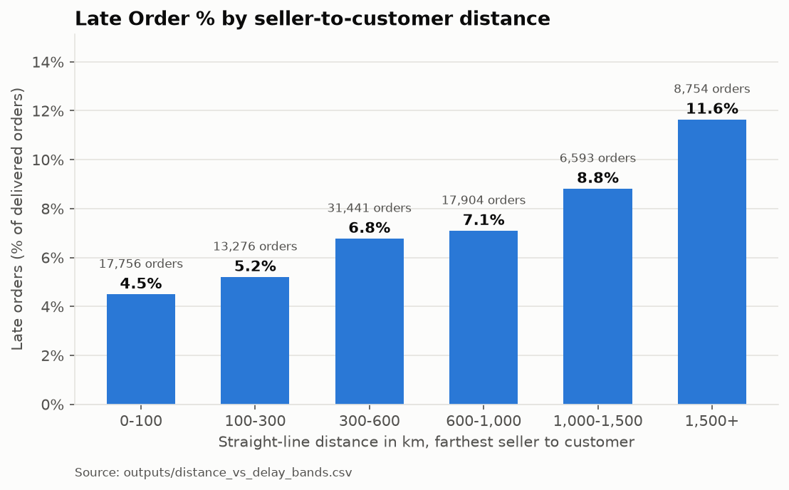
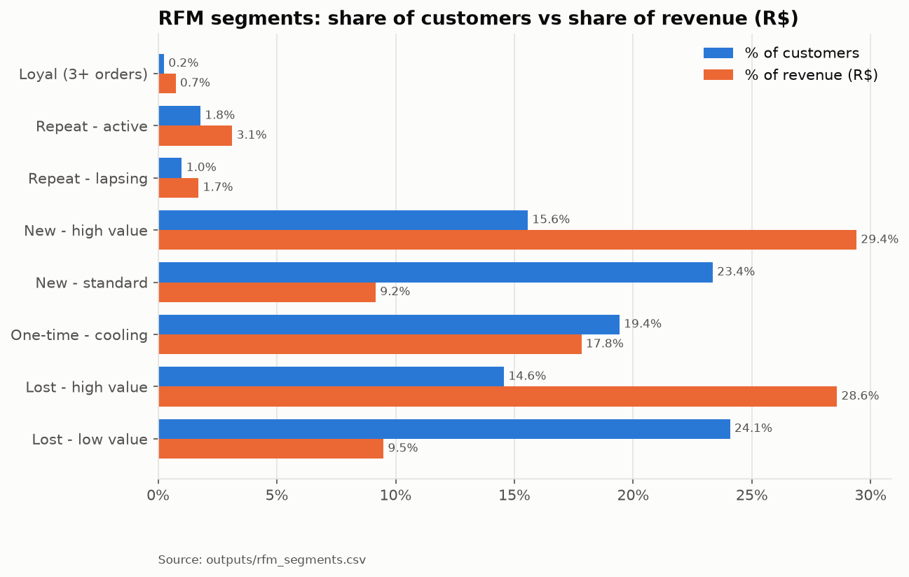

# Olist Customer Retention & Delivery Experience Analysis

**Late deliveries cost Olist about 2 review stars, but 74% of those late-order reviews were written before the parcel
arrived.** Only 3% of customers buy twice, and 15.56% of customers ("New - high value") hold 29.40% of revenue.
End-to-end project on ~100K Brazilian e-commerce orders: MySQL data model, data-quality checks, Python statistics,
an Excel scorecard, a Power BI specification and business-analysis documents.

*Author: Bala Hariharan B · [github.com/Balahari29](https://github.com/Balahari29) · Data: Kaggle
[`olistbr/brazilian-ecommerce`](https://www.kaggle.com/datasets/olistbr/brazilian-ecommerce) · All money in R$ (BRL).*

## Business questions
1. What % of customers buy again, and what does monthly cohort retention look like?
2. Do late deliveries lower review scores, and by how much?
3. Which sellers, categories and states cause the most delivery delays?
4. Which customer segments (RFM) should marketing target?
5. How concentrated is revenue across categories and states (Pareto)?

## Key findings
| # | Finding | Source |
|---|---|---|
| 1 | **Late orders score 2.02 stars lower** (2.27 vs 4.29; 95% CI 1.98-2.06; Mann-Whitney p < 0.001, rank-biserial −0.64). **74% of late-order reviews were written before delivery**; counting only reviews written after delivery, the gap is **0.76 stars** | `outputs/hypothesis_test_results.csv`, `outputs/hypothesis_test_conclusion.txt` |
| 2 | The score falls with every day of delay: **4.29 stars when early, 1.70 when 7+ days late** | `outputs/delivery_buckets_vs_review.csv` |
| 3 | **96.97% of customers bought only once**; repeat customer rate 3.03%; only 1.42-2.28% of a cohort returns within 6 months | `outputs/retention_orders_per_customer.csv`, `outputs/retention_repeat_customers.csv`, `outputs/retention_cohort_6m_window.csv` |
| 4 | Long routes are under-buffered: late % rises from **4.49% (under 100 km) to 11.64% (over 1,500 km)**; AL (21.46%) and MA (17.53%) are the worst states vs 6.79% overall | `outputs/distance_vs_delay_bands.csv`, `outputs/delivery_ontime_by_state.csv` |
| 5 | Ranked by **excess late orders** (above an average seller of the same size), the top 20 sellers account for **457**; the #1 seller ranks only #135 on late rate | `outputs/seller_excess_summary.csv`, `outputs/seller_late_rate_ranking.csv` |
| 6 | **"New - high value" customers: 15.56% of customers, 29.40% of revenue**: the second-purchase campaign target | `outputs/rfm_segments.csv` |
| 7 | Revenue is concentrated: **18 of 74 categories make 80% of revenue**; São Paulo alone brings 38.30% | `outputs/revenue_pareto_summary.csv`, `outputs/revenue_pareto_state.csv` |

Recommendations and their expected impact: [`docs/06_insight_memo.md`](docs/06_insight_memo.md).





More charts in [`images/`](images/) (on-time % by month, late % by state, cohort heatmap, category Pareto).

## Dashboard (Power BI)
*Screenshots to be added after the Windows build (`powerbi/build_steps.md`, Step 12).*

| Page | Screenshot |
|---|---|
| Executive Overview | `images/dashboard_1_executive.png` *(placeholder)* |
| Delivery vs Satisfaction | `images/dashboard_2_delivery.png` *(placeholder)* |
| Customer Segments | `images/dashboard_3_segments.png` *(placeholder)* |
| Seller Performance (with drill-through) | `images/dashboard_4_sellers.png` *(placeholder)* |

## Tech stack
| Area | Tools and techniques |
|---|---|
| Database | MySQL 8.4: star schema with PKs/FKs, CTEs, window functions (`ROW_NUMBER`, `RANK`, `NTILE`, `LAG`, running `SUM`), views |
| Python | pandas, NumPy, SciPy (Mann-Whitney U, chi-square, Spearman, bootstrap), matplotlib, seaborn, SQLAlchemy, PyMySQL, Jupyter |
| Excel | Microsoft 365: Excel Table, `XLOOKUP`, `RANK.EQ`, `PERCENTILE.INC`, conditional formatting, What-If Data Table, Power Query, PivotTable + slicer (workbook built with openpyxl) |
| Power BI | Star schema, relationships, marked date table, DAX measures (time intelligence, `SUMX`, `ADDCOLUMNS`), drill-through |
| Business analysis | BRD, KPI dictionary, user stories with acceptance criteria, process map (draw.io), UAT checklist, insight memo |

## Project structure
```
olist-retention-analysis/
├── README.md                     this file
├── CLAUDE.md                     project brief and working rules
├── requirements.txt              Python packages (exact versions: requirements-lock.txt)
├── .env.example                  MySQL credentials template (.env itself is git-ignored)
├── data/raw/                     Kaggle CSVs (git-ignored, never edited)
├── docs/
│   ├── 01_BRD.md                 business requirements
│   ├── 02_KPI_dictionary.md      KPI definitions and formulas
│   ├── 03_user_stories.md        US-01 to US-06 with acceptance criteria
│   ├── 04_process_map_steps.md   order-to-review process (04_process_map.drawio: to draw)
│   ├── 05_UAT_checklist.md       51 dashboard checks with expected values
│   ├── 06_insight_memo.md        findings and 3 recommendations
│   ├── project_log.md            detailed phase notes and decisions
│   ├── resume_bullets.md
│   └── linkedin_post.md
├── sql/
│   ├── 01_schema.sql             tables, keys, indexes
│   ├── 02_data_quality_checks.sql
│   ├── 03_clean_layer.sql        views that apply the data rules
│   ├── 03_analysis_retention.sql
│   ├── 04_analysis_delivery.sql
│   ├── 05_analysis_sellers_categories.sql
│   └── 06_views_for_powerbi.sql  star-schema views + UAT expected values
├── src/
│   ├── load_to_mysql.py          CSV → MySQL, row-count reconciliation
│   ├── run_dq_checks.py          runs 02_*.sql → outputs/dq_*.csv
│   ├── run_analysis.py           runs 03-06 → outputs/
│   ├── export_views.py           views → excel/ and powerbi/data/ CSVs
│   └── build_seller_scorecard.py builds excel/seller_scorecard.xlsx
├── notebooks/analysis.ipynb      RFM, hypothesis tests, distance, charts
├── excel/                        seller scorecard workbook, its data, manual steps
├── powerbi/                      model spec, DAX, page layout, build steps
│   └── data/                     star-schema CSVs (git-ignored; regenerate)
├── outputs/                      every result cited in the docs (CSV/TXT)
└── images/                       charts (and dashboard screenshots)
```

## How to reproduce
```bash
# 1. Python environment
python3 -m venv .venv && .venv/bin/pip install -r requirements.txt

# 2. MySQL 8 (macOS example) and credentials
brew install mysql@8.4 && brew services start mysql@8.4
cp .env.example .env                       # then set MYSQL_PASSWORD in .env

# 3. Data (Kaggle CLI with an API token, or download manually into data/raw/)
.venv/bin/kaggle datasets download -d olistbr/brazilian-ecommerce -p data/raw --unzip

# 4. Pipeline
.venv/bin/python src/load_to_mysql.py      # schema + load + outputs/row_counts.csv
.venv/bin/python src/run_dq_checks.py      # data-quality checks -> outputs/dq_*.csv
.venv/bin/python src/run_analysis.py       # clean layer, analysis, Power BI views -> outputs/
.venv/bin/jupyter nbconvert --to notebook --execute --inplace notebooks/analysis.ipynb
.venv/bin/python src/export_views.py       # excel/seller_scorecard_data.csv + powerbi/data/*.csv
.venv/bin/python src/build_seller_scorecard.py
```
Then: Excel manual steps in `excel/manual_steps.md`. **Power BI: regenerate with `export_views.py`, then copy the
folder to the Windows PC.** For an easy copy: `zip -r powerbi_data.zip powerbi/data outputs/retention_cohort_long.csv
outputs/distance_vs_delay_bands.csv outputs/retention_first_order_late_vs_on_time.csv outputs/rfm_segments.csv`
(git-ignored), then follow `powerbi/build_steps.md`.

## Data rules (summary)
Applied once, in `sql/03_clean_layer.sql`; full reasoning in [`docs/project_log.md`](docs/project_log.md).
1. **Valid orders:** status delivered, shipped, invoiced, processing or approved; purchases **2017-01-01 to
   2018-08-31** (2016 is sparse with a missing month; Sep-Oct 2018 has 20 orders, none delivered,
   `outputs/dq_orders_per_month.csv`).
2. **Customers** are `customer_unique_id` (`customer_id` changes with every order).
3. **Delivery KPIs:** delivered orders with a delivery date and an estimated date on or before the last purchase date.
   On time = delivered on or before the estimated **date**.
4. **Reviews:** one per order (latest answered); hypothesis tests use one row per `review_id`.
5. **Cohorts** are compared on equal observation windows (6 months).
6. **Timestamp anomalies** (carrier pick-up before approval) are flagged, not dropped.
7. **Revenue** = product price, excluding freight, in R$.

## Limitations
- **Correios strike (March 2018):** the timing matches the late-delivery peak, but the state pattern does not; this is
  an explanation consistent with the data, not proof (`outputs/delivery_spike_strike_states.csv`).
- **February 2018's late-delivery spike is unexplained.**
- **Late first order vs repeat purchase is inconclusive:** 1.47% vs 1.79%, p = 0.161, and the test could only detect
  gaps of about 0.63 points (`outputs/retention_first_order_late_test.csv`).
- **Data is from 2016-2018** and may not reflect Olist today; no cost data, so no profit analysis.
- Distances are straight-line (haversine), not road routes; review comments (Portuguese text) were not analysed.

## Documentation
- Business: [BRD](docs/01_BRD.md) · [KPI dictionary](docs/02_KPI_dictionary.md) · [User stories](docs/03_user_stories.md) ·
  [Process map steps](docs/04_process_map_steps.md) · [UAT checklist](docs/05_UAT_checklist.md) ·
  [Insight memo](docs/06_insight_memo.md)
- Technical: [Project log](docs/project_log.md) (schema, data quality, rules, every analysis decision) ·
  [Power BI model](powerbi/model_spec.md) · [DAX measures](powerbi/dax_measures.md) ·
  [Page layout](powerbi/page_layout.md) · [Excel steps](excel/manual_steps.md)
